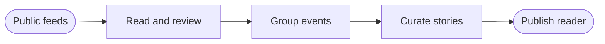

  <a href="https://asif-jc.github.io/daily-news-letter-public/"><strong>Read the latest edition</strong></a> ·
  <a href="#see-it-in-action">Watch the tour</a> ·
  <a href="#how-it-works">How it works</a>

A small public project for keeping up with the world and learning something along the way. Politics, technology, science and economics, with a place for New Zealand's own stories. Open one page, follow your curiosity, and leave with a little more context.

## What you get

- **The story, with context.** Short summaries, supported significance where available, and links to the original reporting.
- **A few leads, plenty to explore.** Up to six featured stories, followed by a browsable topic collection.
- **Your corner of the world.** Filter by topic and place, including NZ politics and economic news.
- **Room to catch up.** A seven-day pool distinguishes new reporting, updates and older stories worth a look.
- **A place to leave off.** Mark stories read explicitly. Your reading state stays in your browser.

## See it in action

[Download the 20-second video with sound](docs/assets/reader-tour.mp4?raw=true). Made with [Brag](https://github.com/latent-spaces/brag), using the 26 October 2026 edition. Headlines and counts change between editions. [Media credits](docs/assets/README.md).

## How it works

A small model-assisted workflow turns overlapping reports into a reading page. Sources and decisions are retained so we can inspect what made it through.

| Node | What happens |
|---|---|
| `feeds` | Collect reporting from the starting source set below. |
| `analysis` | Draft and check article summaries against retained evidence; withhold flagged material. |
| `events` | Compare reports about the same event so their sources can travel together. |
| `editorial` | Assess relevance and importance, then choose featured stories and keep other relevant stories browsable. |
| `reader` | Review combined summaries, build the page and publish the intended reader fields. |

Model-assisted summaries can still be wrong. Source links and review are part of the project, and publication follows review.

## The starting reading list

[BBC World](https://www.bbc.com/news/world) · [Ars Technica](https://arstechnica.com/) · [TechCrunch](https://techcrunch.com/) · [CNBC Finance](https://www.cnbc.com/finance/) · [RNZ Politics](https://www.rnz.co.nz/news/political) · [RNZ Business](https://www.rnz.co.nz/news/business)

Six feeds from five publishers give this first version its mix of world affairs, technology, science, business and NZ coverage. The aim is a useful reading habit, with enough breadth to find something you weren't already looking for.

## Built in the open

Python, PostgreSQL and a language model behind a static HTML reader. The interesting work is deciding which reports belong together, what matters, and how to explain it clearly. The code and [editorial preferences](src/news/profile.json) are here to explore.

Editions are currently generated and published manually. The project is focused on news.

For the machinery: [running and development](docs/operations.md) · [source catalogue](src/news/sources.py) · [workflow](src/news/workflow.py).
