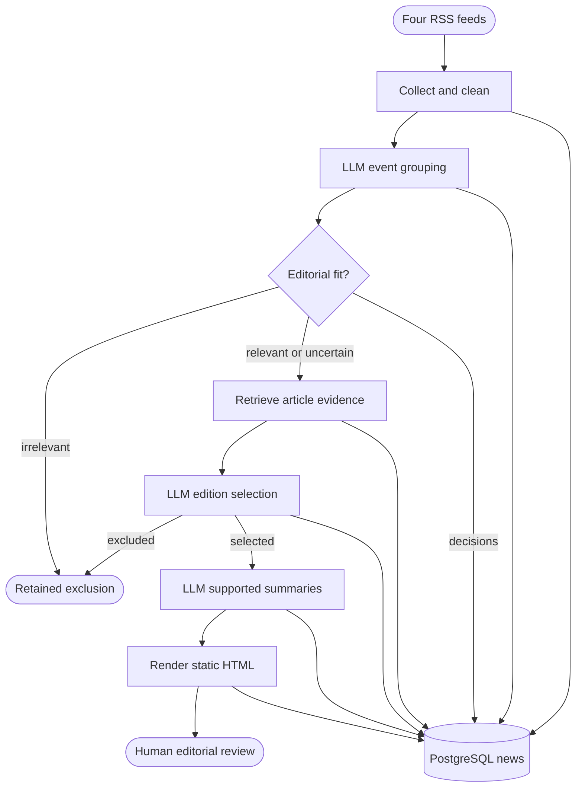

# News-only retained workflow

Four RSS feeds become a private reader edition; PostgreSQL retains observations and every decision, while publication remains a separate approval checkpoint.

| Node | Does | In / Out | Where | Watch |
|---|---|---|---|---|
| `feeds` | Reads the four approved publishers | BBC World, TechCrunch, Ars Technica, CNBC Finance / first 50 RSS entries each | `sources.py`, `collect_articles` | RSS windows limit observed coverage; no search or source discovery |
| `clean` | Retains all observations, then applies eligibility and exact URL deduplication | RSS metadata / at most 100 candidates and explicit exclusions | `pipeline.py`, `events.py`, `store.py` | 24-hour window uses published, otherwise updated date. Unknown dates rejected. Publisher-balanced budget is a workload limit, not relevance |
| `group` | Combines coverage of a specific event and compares supplied published/reviewed history | Titles/descriptions/dates and history / event memberships, reasons and novelty | `events.py`, `llm.py` | Metadata can miss distinctions in bodies. Generic topic similarity is insufficient. Singletons are preserved |
| `qualify` | Applies the explicit editorial profile with the LLM | Events and profile / relevant, irrelevant or uncertain with reasons | `editorial.py`, `profile.json`, `llm.py` | Uncertain survives. Importance alone is not fit. Repeat history is scoped to this briefing |
| `excluded` | Retains reasons without deleting source observations | Article or event / eligibility or profile-versioned decision | `store.py`, `workflow.py` | Final reasons distinguish off-brief, insufficient evidence, already-covered and crowded-out |
| `retrieve` | Fetches up to three supporting articles per qualified event | Publisher URLs / evidence text, basis, timestamp, hash and status | `pipeline.py`, `workflow.py` | Only approved publisher hosts/redirects. Failure becomes explicit RSS-summary fallback |
| `select` | Ranks the whole qualified pool using retrieved evidence | Profile and bounded evidence / complete top, quick or exclude decisions | `editorial.py`, `llm.py` | Total evidence text cap 60,000 characters. Five leads and ten quick reads are maxima, not quotas; judgments still need review |
| `synthesize` | Generates concise summaries and significance with source-passage references | Selected event and evidence / story with validated passages | `pipeline.py`, `llm.py` | Traceability is not proof of entailment or factual accuracy; incomplete calls may repeat on resume |
| `render` | Saves reader and private review HTML with versioned checkpoints and separate export attempts | Immutable edition snapshot / local HTML and file hashes | `render.py`, `workflow.py` | Reader fields are separate from private prompts/decisions/excerpts. No public deployment or email |
| `review` | Lets Asif assess the actual edition, source counts, preferences, prompts and decisions | Local reader and private review page / editorial feedback | `.local/news-editions/`, `dispatch_report.html` | Main merge and deployment need explicit release review; no publication command is installed |
| `database` | Retains relational identities/memberships and JSONB snapshots/audit | Stage writes / queryable history, checkpoints, editions and size samples | `store.py`, `migrations/001_news.sql` | Only database `news`; migrations stay in its news schema. Backups and retention need operational ownership |

## Reading

Read the current `src/news` workflow, store, editorial stages, renderer and prompts. Tested against the isolated server database; no other database configuration changed.
The 19 October run retained 100 observations and produced eight stories; 44 tests passed and nine real-model grouping cases passed. See the linked dispatch report for executed evidence.
Rendering is the implemented endpoint. Publication is approval-gated and deliberately outside this workflow; future profiles reuse retained news rather than changing ingestion.
